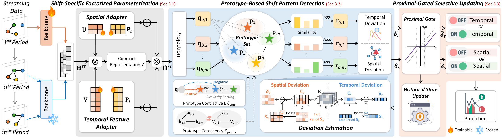

<div align="center">

# S³A

### Which Parameters to Update? Shift-Specific Selective Adaptation for Continual Spatio-Temporal Prediction

<p><em>Paper under review</em></p>

</div>

<div align="center">

⭐ S³A is a plug-and-play shift-specific selective adaptation framework for continual spatio-temporal prediction.

</div>

## Updates/News

🚩 **News (Oct. 2026):** S³A has been released as an open-source framework for continual spatio-temporal prediction.

## 📖 Introduction

Online urban services and sensing infrastructure continuously generate large-scale streaming spatio-temporal data, where spatial correlations and observation distributions shift independently or jointly over time, resulting in diverse shift patterns across periods. Existing methods typically adapt by fine-tuning the backbone or uniformly updating predefined adaptation parameters, but do not distinguish these shift patterns, making it difficult to adapt to shifts in spatial correlations or observation distributions while preserving the modeling of the other when it remains stationary, thereby compromising continual adaptation stability.

To address this issue, we propose **S³A**, a plug-and-play **S**hift-**S**pecific **S**elective **A**daptation framework for continual spatio-temporal prediction. S³A constructs separate adaptation parameters for spatial correlations and observation distributions, detects shift patterns, and selectively updates the corresponding parameters.

Specifically:

- **Factorized parameterization** along the node and temporal-feature dimensions enables separate adaptation of spatial correlations and observation distributions.
- **Prototype-based detection** measures deviations from historical prototype states to characterize shift patterns.
- A **proximal-gated selective updating** module identifies substantive shifts and updates the corresponding parameters.

Extensive experiments on three real-world spatio-temporal datasets show that S³A consistently improves four representative backbones and demonstrates the benefits of shift-specific selective adaptation for maintaining stable performance.

<p align="center">
    
</p>

## 📊 Datasets

The framework supports the following streaming spatio-temporal datasets:

| Dataset | Description | Scenario |
|----------|-------------|----------|
| **PEMS03-Stream** | Streaming traffic data derived from PEMS03 | Traffic forecasting |
| **PEMS04-Stream** | Streaming traffic data derived from PEMS04 | Traffic forecasting |
| **Air-Stream** | Streaming air quality monitoring data | Air quality forecasting |

### Dataset Download
- **PEMS03-Stream** and **AIR-Stream**: Available from the [EAC repository](https://github.com/Onedean/EAC)
- **PEMS04-Stream**: Available from the [TEAM repository](https://github.com/kvmduc/TEAM-topo-evo-traffic-forecasting)

Please download the datasets and place them in the `data/` directory.

**Directory names should be kept as follows:**

```text
data/
├── PEMS03/
├── PEMS04/
└── AIR/
```

## 🚀 Getting Started

### Installation

Create and activate the environment:

```bash
conda env create -f environment.yaml
conda activate stg
```

### Quick Start

S³A is a plug-and-play continual adaptation framework that can be integrated into different streaming spatio-temporal forecasting backbones.

#### Example 1: S³A + EAC

```bash
python main.py \
    --conf conf/PEMS03/eac_S3A.json \
    --gpuid 0 \
    --seed 43
```

#### Example 2: S³A + STBP

```bash
python mainSTBP_S3A.py \
    --conf conf/PEMS03/STBP_S3A.json \
    --gpuid 0 \
    --seed 43
```

#### Example 3: S³A + DCRNN

```bash
python main.py \
    --conf conf/PEMS03/DCRNN_S3A.json \
    --gpuid 0 \
    --seed 43
```

#### Example 4: S³A + PDFormer

```bash
python main.py \
    --conf conf/PEMS03/PDFormer_S3A.json \
    --gpuid 0 \
    --seed 43
```

#### Run All Experiments

To reproduce all experiments reported in the paper:

```bash
bash scripts/run_all.sh
```

| Backbone | Model Family | Variant |
|-----------|-------------|----------|
| DCRNN | RNN-based | DCRNN w/ S³A |
| PDFormer | Transformer-based | PDFormer w/ S³A |
| EAC | STGNN-based | EAC w/ S³A |
| STBP | Frequency-based | STBP w/ S³A |

S³A is not a standalone forecasting model.

Instead, it functions as a shift-specific selective adaptation framework that can be seamlessly integrated into diverse streaming spatio-temporal forecasting backbones, including RNN-based, Transformer-based, STGNN-based, and frequency-based architectures.


## 🔗 Acknowledgement

We gratefully acknowledge the following open-source projects, whose codebases, datasets, and research insights have supported the development of this work:

- [EAC](https://github.com/Onedean/EAC)
- [STBP](https://github.com/Aoyu-Liu/STBP)
- [DCRNN](https://github.com/liyaguang/DCRNN)
- [PDFormer](https://github.com/BUAABIGSCity/PDFormer)
- [TrafficStream](https://github.com/AprLie/TrafficStream)
- [STKEC](https://github.com/wangbinwu13116175205/STKEC)

We thank the authors for their valuable contributions to the spatio-temporal forecasting and continual learning communities.
